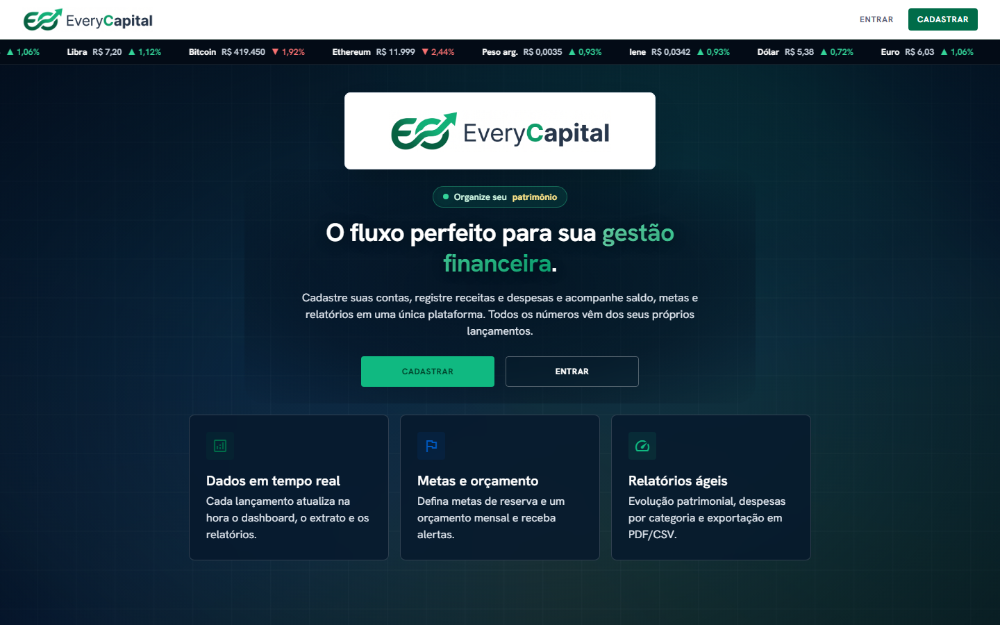
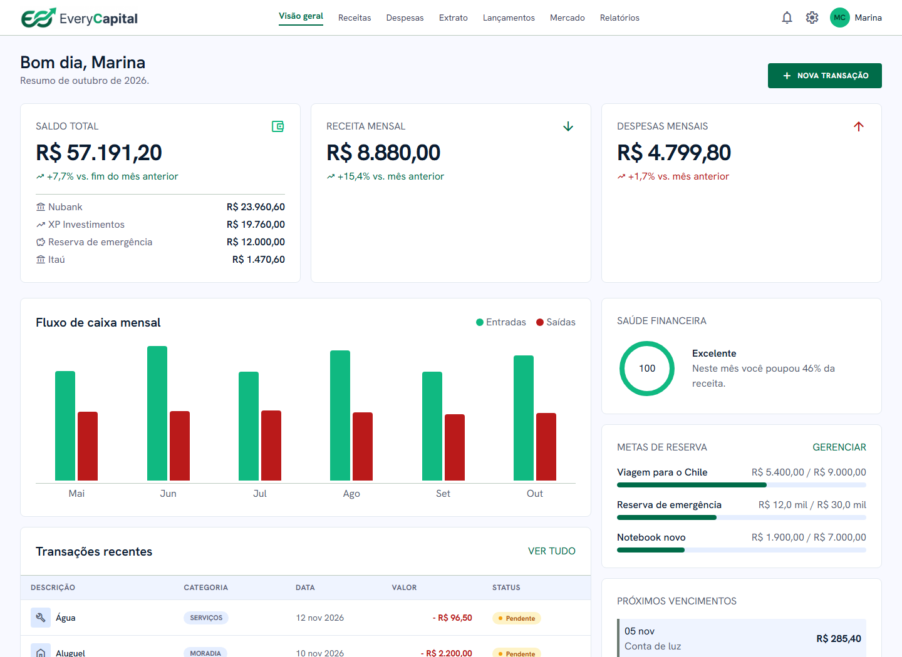
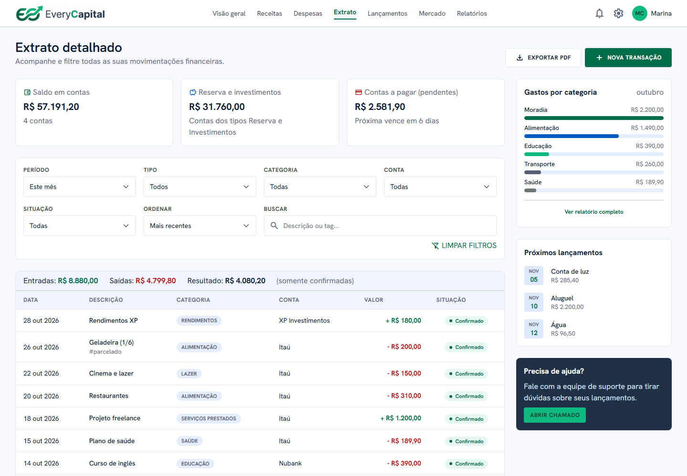
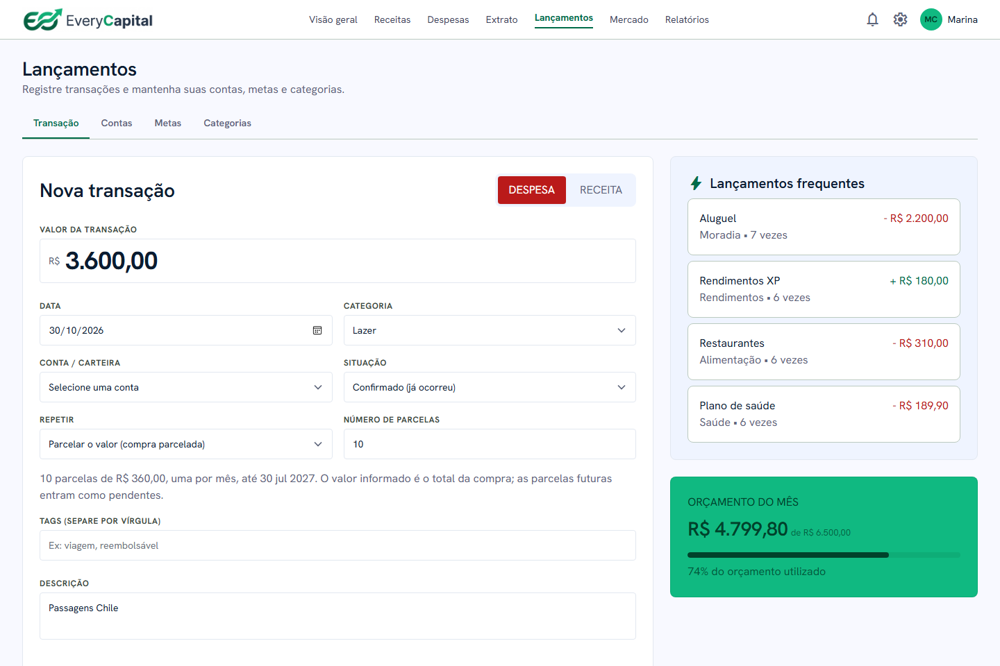
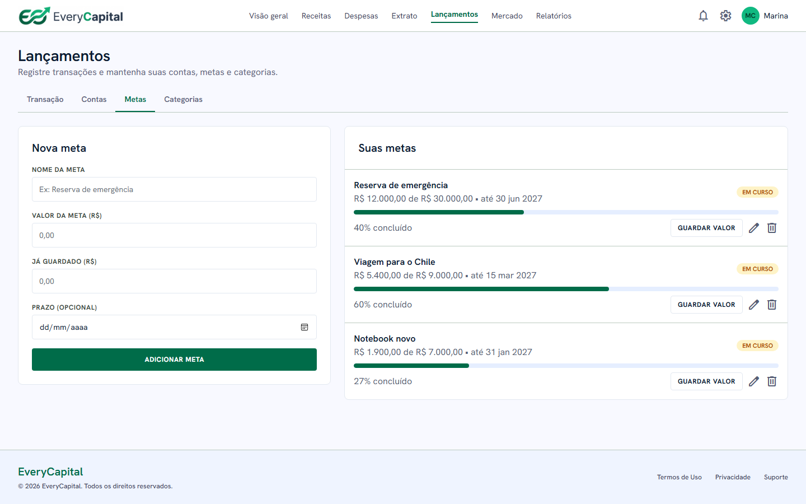
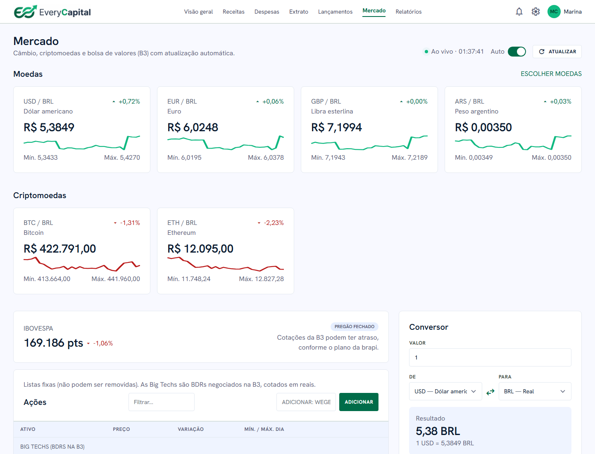
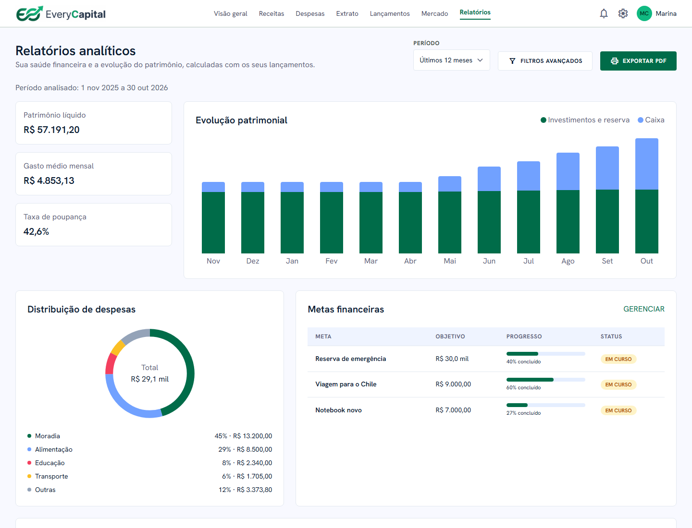
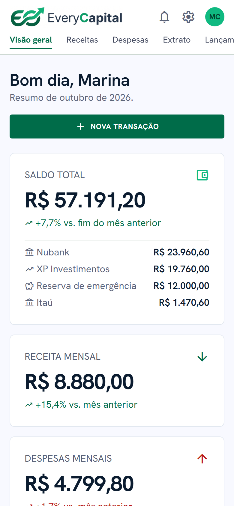
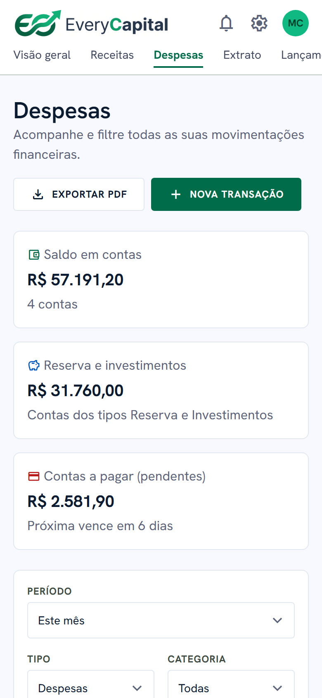

# EveryCapital

**Plataforma web de gestão financeira pessoal e empresarial:** contas, receitas e despesas, metas,
relatórios e cotações da bolsa (B3), câmbio e criptomoedas, com plano grátis e Premium.

> 🔒 Este repositório é uma **vitrine** do projeto. O código-fonte fica em um repositório privado,
> porque o EveryCapital está sendo preparado para virar produto. Posso mostrar o código e explicar
> as decisões técnicas em uma conversa.
>
> Projeto desenvolvido em dupla com [Lucas Pacifico](https://github.com/LucasPacifico0).
> As telas abaixo usam **dados fictícios**.

## Telas

### Visão geral
Saldo total com o valor de cada conta, receitas e despesas do mês comparadas ao mês anterior,
fluxo de caixa dos últimos 6 meses, nota de saúde financeira, metas e próximos vencimentos.

### Extrato
Filtros por período, tipo, categoria, conta e situação, busca, ordenação, paginação e gastos por categoria.

### Lançamentos, com compra parcelada
Uma compra de R$ 3.600 em 10 vezes vira 10 lançamentos mensais; o formulário mostra o resultado antes de salvar.

### Metas

### Mercado
Câmbio e criptomoedas em tempo real, com gráfico do dia, Ibovespa, ações da B3, lista própria de
ativos e conversor de moedas.

### Relatórios
Evolução do patrimônio, distribuição de despesas, taxa de poupança e metas.

### No celular

  
  &nbsp;&nbsp;
  

## Funcionalidades

- Cadastro e login com e-mail e senha ou com o Google.
- Contas (corrente, reserva, investimentos, carteira e cartão de crédito) com saldo calculado a partir dos lançamentos.
- Receitas e despesas com categoria, situação (confirmado ou pendente) e tags.
- **Parcelamento** e **lançamentos mensais repetidos**.
- Metas de reserva com progresso e prazo.
- Orçamento mensal com alertas de 80% e de estouro, e alertas de contas a vencer.
- Relatórios com exportação em PDF.
- Cotações da B3 (brapi.dev), câmbio e criptomoedas (AwesomeAPI).
- **Plano grátis e Premium**, com os limites aplicados no servidor (não só na tela).

## Tecnologias

| Camada | Tecnologia |
|---|---|
| Front-end | HTML, JavaScript (sem framework) e Tailwind CSS compilado |
| Back-end | Node.js (servidor HTTP próprio, sem framework) |
| Banco de dados | MySQL 8 |
| Integrações | brapi.dev (B3), AwesomeAPI (câmbio e cripto), Google Identity (login) |
| Testes | `node:test`, com SQLite em memória e uma API simulada (66 testes) |
| Produção | Nginx (HTTPS, cabeçalhos de segurança, CSP, gzip, limite de requisições) e PM2 |

**Arquitetura em resumo:**
- **Dados no servidor:** o navegador trabalha sobre uma cópia em memória e envia ao servidor só o que mudou, em lote e numa transação.
- **Isolamento por usuário:** cada consulta é filtrada pelo usuário da sessão.
- **Chave da API protegida:** a chave da brapi fica só no servidor, que faz o papel de intermediário com cache.

## Segurança

- Senhas com **scrypt** (parâmetros recomendados pela OWASP), com atualização automática de hashes antigos.
- **Sessão** em cookie `HttpOnly` / `SameSite`; o banco guarda só o hash do token.
- **Proteção contra:**
  - SQL injection, com consultas parametrizadas;
  - CSRF, conferindo a origem das requisições e exigindo JSON;
  - XSS, escapando o conteúdo e validando os links no servidor.
- **Limite de tentativas** de login e cadastro, com bloqueio temporário.
- **Senha atual** exigida para trocar o e-mail e para excluir a conta.
- **CSP sem scripts de terceiros nem scripts inline**, HSTS e outros cabeçalhos de segurança no Nginx.
- **Limpeza automática** de sessões vencidas e de registros antigos.

## Minhas contribuições

- **Interface:**
  - navegação com as abas Receitas e Despesas;
  - saldo detalhado por banco;
  - ordenação do extrato;
  - Visão geral mais limpa.
- **Segurança:**
  - correção de uma falha que permitia baixar o código do servidor (path traversal com URL codificada);
  - proteção do endpoint de cotações;
  - correção de XSS;
  - limites do plano aplicados no servidor;
  - scrypt mais forte;
  - limpeza periódica.
- **Concorrência:**
  - IDs definidos pelo servidor, para duas abas criando registros ao mesmo tempo não perderem dados;
  - trava por usuário (`SELECT ... FOR UPDATE`), para dois envios simultâneos não furarem a cota do plano grátis.
- **Parcelamento** e lançamentos mensais repetidos.
- **Build do Tailwind**, no lugar do CDN, e remoção de scripts inline, o que permitiu uma CSP restritiva.
- **Infraestrutura de produção:** configuração do Nginx, do PM2 e das variáveis de ambiente.
- **Testes:** a suíte passou de 55 para 66 testes, cobrindo cada correção.

## Status

Em desenvolvimento. Próximos passos: recuperação de senha e confirmação de e-mail (e-mail transacional),
pagamento do plano Premium, cartões de crédito com fatura, transferências entre contas e área de investimentos.

---

© 2026 EveryCapital. Todos os direitos reservados. As imagens deste repositório não podem ser reutilizadas sem autorização.
